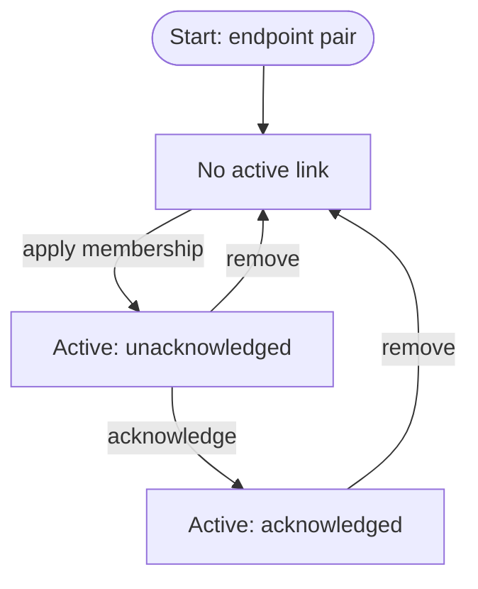
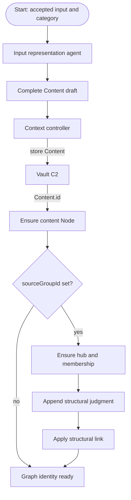
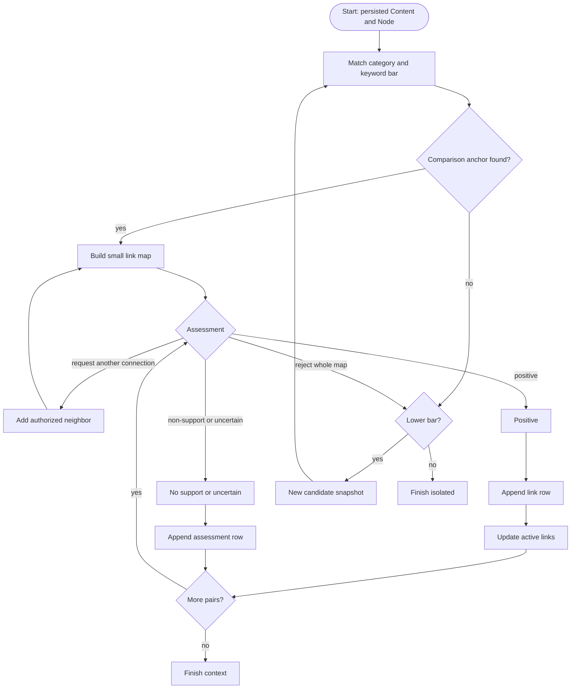
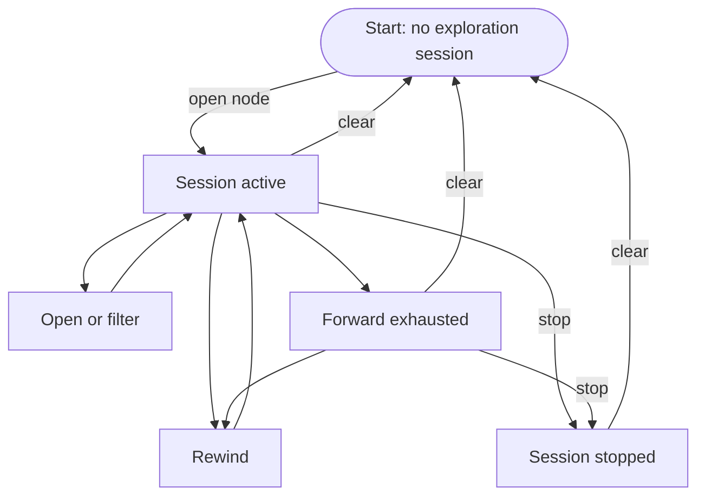

# Raw Context Brain

## At a glance

**Purpose:** Maintain the person-owned contextual index between immutable captured evidence and later semantic processing.

**Owner:** The individual.

**Durable evidence:** Content records in Vault C2, with immutable text and recorded provenance metadata.

**Durable association state:** Graph nodes, judgment history, and person acknowledgement state.

**Derived state:** Active-link projection and candidate index.

**Temporary state:** Placement sessions, exploration sessions, issued actions, and display layout.

**WellBe stage:** Connect.

**Component map:** Vault C2 → Raw Context Brain → processing C4 → knowledge graph C6 → Health Thread C7.

This module maintains one raw-context graph namespace for one person.

Saving content creates its graph address. An active link makes two graph addresses adjacent for retrieval and exploration. The local controller limits what an inference model may read and apply.

When a model evaluates a possible relationship between two Nodes, it receives only the controller's locally advertised, bounded evidence and legal continuations—not the person's full graph.

C4, C6, and C7 later turn the same evidence into typed entities and ongoing concerns. This layer preserves contextual association without assigning those later meanings. Production integration waits for approval of the decision record.

### Responsibility planes

**Evidence plane:** Immutable Content in Vault C2.

**Topology plane:** Durable Nodes, append-only link advertisements, and the accepted active-link projection.

**Policy plane:** Candidate selection, route selection, bounded export, legal continuation, authorization, freshness, and budgets.

These planes separate responsibilities. They are not separate services and do not implement literal network protocols.

---

## Document status

**Status:** The design of this module. Date 2026-10-22.

**Spike:** [WEL-87](https://belias.atlassian.net/browse/WEL-87) — `[Spike] Raw Context Brain Theory Lab`, under Data factory (WEL-2).

Jira RSS export generated Thu Oct 22 16:45:08 UTC 2026: status In Progress, resolution Unresolved, type Story, priority Low, parent WEL-2. The spike stays open.

**Blocks:** WEL-58, auto-linking across the personal graph. WEL-58 stays blocked. Relates to WEL-44, WEL-59, and WEL-69.

**Authority:** Current Raw Context Brain design specification.

**Production status:** The engine lives in `backend/packages/raw_context_brain` and the signed-in person reaches it at `/v2/context`. On a thread, they can start that walk from a record they already opened. Open parameters in the decision record are still open. WEL-58 stays blocked. The lab page remains the picture until a workspace screen replaces it.

**Decision gate:** [Proposed decision record](../../decisions/raw-context-brain-theory-lab.md).

**Implementation evidence:** [Product engine](../../../backend/packages/raw_context_brain) and the [lab picture](../../../labs/raw-context-brain/README.md).

**Historical evidence:** [Dated WEL-87 history](wel-87-history.md). It does not override this design.

**Distinct downstream system:** [C6 Knowledge Graph](../knowledge_graph.md).

**Reading path:** Data model → placement and linking → exploration → graph interface → implementation status.

### Contents

**Data model.** The graph and its persistent records.

- [Tree](#tree) — the person’s raw-context graph namespace.
- [Content](#content) — one immutable evidence record in the vault.
- [Node](#node) — one stable graph address.
- [Link](#link) — one active contextual association.

**Placement and exploration.** How content is linked, navigated, and shown.

- [Category](#category) — the one value every content must have.
- [Candidate retrieval](#candidate-retrieval) — eligibility, ranking, thresholds, and stop rule.
- [Placement session](#placement-session) — temporary state for linking one new content record.
- [Exploration session](#exploration-session) — snapshot-bound navigation from one graph address.
- [Context graph explorer](#context-graph-explorer) — the person-facing graph interface.

**Components.** The machinery that prepares content, records judgments, and controls model access.

- [Input representation agent](#input-representation-agent) — prepares one complete Content draft.
- [Immutable content store](#immutable-content-store-vault-c2) — Vault C2, the evidence authority.
- [Link judgment ledger](#link-judgment-ledger) — ordered association history.
- [Active-link projection](#active-link-projection) — effective topology.
- [Small link map](#small-link-map) — bounded graph context exposed to the model.
- [Context controller](#context-controller-router) — trusted policy and orchestration boundary.
- [Association assessment model](#association-assessment-model) — constrained evaluator.

**Reference.**

- [Flows](#flows) — charts and sequences.
- [Design status](#design-status)
- [Cross-cutting invariants](#cross-cutting-invariants)
- [Sources and authority](#sources-and-authority)
- [Lab implementation gaps](lab-implementation-gaps.md)
- [WEL-87 history](wel-87-history.md)
- [Design-session clarifications](design-session-2026-10-22.md)

---

## Data model

The data model separates evidence custody, graph identity, judgment history, effective topology, and temporary session state.

```
one person
  one Tree
    Node — stable graph address for Content or a source-group hub
      contentId → immutable Content record in Vault C2
    Link — active undirected association between two Node ids
    Link judgment ledger — ordered history behind active membership
```

### Four kinds of network state

**Durable Link:** The currently accepted contextual adjacency between two Nodes.

**Topology advertisement:** An append-only link judgment from which accepted topology is projected.

**Candidate route:** A controller-internal possibility considered during placement or exploration. It is not graph state.

**Navigation route:** A temporary, session-bound legal continuation advertised by the controller. It is not a Link and does not become persistent topology.

### Tree

**Definition:** The Tree is the product name for one person’s raw-context graph namespace.

It contains persistent graph addresses and the contextual associations currently active between them.

Its topology may be disconnected or cyclic. It has no stored root, parent, or direction.

**Identity:** The graph is scoped by `personId`. It has no separate stored tree id.

**Starts:** Empty.

**Node membership:** Nodes whose `personId` is this person.

**Link membership:** The [active-link projection](#active-link-projection) for unordered endpoint pairs in that node set.

**Text storage:** Vault C2.

**Node revision:** Advances when node membership or hub membership changes.

Opening a node creates an [exploration session](#exploration-session) over one pinned graph snapshot.

### Content

**Definition:** One Vault evidence record representing one accepted input for this module.

Its `text` is the canonical string used as evidence.

Its metadata preserves ownership, capture time, input representation, arrival path, intake grouping, source-family standing, copy provenance, and candidate category.

**Creation boundary:** Every input passes the [input representation agent](#input-representation-agent).

**Identity:** `id` identifies this accepted content record. `contentHash` detects identical strings; it does not merge their identities.

**Storage:** Vault C2 writes `text` once. Later judgments resolve and read that immutable payload.

**Metadata updates:** A later source-family assignment is a recorded provenance update to `sourceFamilyId` and `sourceFamilyStanding`. It does not alter `id`, `text`, `contentHash`, or capture identity.

**Graph reference:** A content node stores this `Content.id` in `Node.contentId`. The node does not copy `text`.

**Evidence family:** Equal non-null `sourceFamilyId` values mean the records come from one source of evidence. They are not independent corroboration.

**Intake group:** Equal non-null `sourceGroupId` values mean the contents arrived together. This is separate from evidence-family identity.

**Standing invariant:** `sourceFamilyStanding = "known"` requires a non-null `sourceFamilyId`.

**Schema.** Names below are the design names. The lab column is the current lab key when it differs.

| Key | Type | Description | Lab key |
|---|---|---|---|
| `id` | `string` | Stable identity of this content | — |
| `personId` | `string` | Owner and graph namespace | — |
| `capturedAt` | `string` | Capture time, ISO-8601. A close-in-time link is a separate judgment, with reason `temporal_neighbour` | — |
| `recordKind` | `"statement" \| "document" \| "capture"` | Representation of the accepted input. See [Record kind](#record-kind). Explorer color is in [Context graph explorer](#context-graph-explorer) | `sourceType` |
| `text` | `string` | Approved string. Written once | — |
| `contentHash` | `string` | Hash of `text`. Identifies an identical string | — |
| `sourceFamilyId` | `string \| null` | Shared id for one source of evidence. Distinct strings from that source share it, such as a laboratory PDF and a clinic letter that quotes it. Link confidence can rise only with a new known family. Null until assigned | `lineageId` |
| `sourceFamilyStanding` | `"known" \| "unknown"` | Whether `sourceFamilyId` counts as an independent source. Unset is `unknown`. Only `known` counts toward confidence | `independence` (`source_family` or `unknown`) |
| `arrival` | `"typed" \| "copied" \| "imported"` | How it entered. See [Record kind](#record-kind) | `sourceArrival` |
| `copiedFromId` | `string \| null` | Referenced `Content.id` when this record was copied from another. Null otherwise. The reference does not itself create a link | — |
| `sourceGroupId` | `string \| null` | Groups contents that arrived together from one intake. Null when the content stands alone. See [Node kinds](#node-kinds) | `documentId` |
| `category` | `string` | Required retrieval partition. Set by the person, or suggested by the input representation agent. See [Category](#category) | none |

### Node

**Definition:** A stable graph address through which the association layer refers to either one Vault content record or one source-group hub.

The node supplies topology identity without copying evidence.

Its location on a visible chain or branch is determined by active links and the exploration anchor. No parent or branch position is stored on the Node itself.

**Content node:** Stores one `Content.id` in `contentId`. It has no members.

**Hub node:** Represents one `sourceGroupId`. It stores member `Content.id` values and has no content or text of its own.

**Adjacency:** Zero or more active links may reference its `Node.id`.

**Identity convention:** A content node currently uses its content id as its node id. The two fields still name different domains: graph identity and evidence identity.

**Group invariant:** Every Content with a non-null `sourceGroupId` has its own content node and belongs to exactly one deterministic hub for that person and group.

**Membership link:** The controller appends a policy-authored `same_record_group` judgment for each content-node/hub pair. Updating the group adds missing members and membership links idempotently.

**Group correction:** A person correction to a `same_record_group` association updates the underlying source-group membership. While that membership remains, its structural link is derived and cannot be suppressed independently.

**Empty group:** When the final member leaves a source group, the controller removes the empty hub and its structural links and advances the Tree node revision.

**Schema.** Names below are the design names. The lab column is the current lab key when it differs.

| Key | Type | Description | Lab key |
|---|---|---|---|
| `id` | `string` | Stable identity. A hub id is `hub_{personId}_{sourceGroupId}` | — |
| `nodeKind` | `"content" \| "hub"` | See [Node kinds](#node-kinds) | `kind` (`event` or `pseudonode`) |
| `contentId` | `string \| null` | Referenced `Content.id`. Required for a content node; null for a hub | `vaultEventId` |
| `memberContentIds` | `string[]` | Referenced `Content.id` values. Empty for a content node; one or more for a hub | `memberEventIds` |
| `personId` | `string` | Owner, the same person as the content | — |

#### Node kinds

| Kind | What it is |
|---|---|
| Content | Graph address for exactly one Vault content record. `contentId` is required; `memberContentIds` is empty |
| Hub | Structural address for one intake group. Its id is `hub_{personId}_{sourceGroupId}`; `contentId` is null; `memberContentIds` holds the group’s Content ids |

#### Record kind

This is `recordKind` on the content.

| Stored name | What it is |
|---|---|
| `statement` | The input was already words. |
| `document` | The input was a file. |
| `capture` | The input was a scan or a picture. |

**Arrival:** Transport into WellBe: typed, copied, or imported.

**Record kind:** Representation of the accepted input: statement, document, or capture.

**Category:** Controlled retrieval partition used before candidate ranking.

**Source group:** Intake co-membership.

**Source family:** Evidentiary dependence.

These fields are separate metadata axes.

### Link

**Definition:** The active, undirected contextual association between two graph addresses.

It makes the endpoints adjacent for candidate retrieval, exploration, and display.

It preserves discoverability before later semantic processing. It does not assign a clinical entity, diagnosis, cause, severity, or truth value.

**Pair identity:** Two distinct `Node.id` values sorted into canonical order. Ordering defines identity, not direction.

**Defining judgment:** `judgmentId` references the ledger row that currently supplies relation, reason, confidence, evidence, and writer.

**Evidence:** Each `evidenceIds` entry is a `Content.id`. When confidence rises, retained evidence is the canonical union of prior and newly accepted evidence ids.

**Acknowledgement:** Durable person-state associated with the active endpoint pair. It changes presentation, not membership or confidence.

**Confidence:** Retained evidence support for this contextual association. An increase requires evidence from a known `sourceFamilyId` absent from the current link’s evidence.

**Removal:** A person’s non-link correction or an explicit withdrawal. Model non-support and uncertainty preserve an existing link.

**Boundary:** A Link is durable accepted topology. It is not a candidate route, a topology advertisement, or a temporary exploration step.

**Schema.** This is the projected active-link record. The lab calls it an accepted edge; the lab column shows its current key when it differs.

| Key | Type | Description | Lab key |
|---|---|---|---|
| `personId` | `string` | Owner, matching both endpoint Nodes | none |
| `judgmentId` | `string` | Link-judgment-ledger row that currently defines this edge | `adId` |
| `endpointIds` | `string[2]` | Two node ids in canonical order | `fromId`, `toId` |
| `relation` | `"explicitly_linked" \| "same_record_group" \| "derived_or_copied" \| "near_in_time" \| "possible_semantic_association" \| "possible_inconsistency"` | See [Relation](#relation) | — |
| `reasonCode` | `string` | Specific rationale supporting the active edge. A temporal association requires `temporal_neighbour`. See [Relation](#relation) | — |
| `confidence` | `number` | Retained confidence, 0 to 1. An increase requires a new known source family | — |
| `evidenceIds` | `string[]` | Referenced `Content.id` values cited as evidence | — |
| `writtenBy` | `"model" \| "person" \| "policy"` | Who wrote the judgment | `origin` (`model`, `user_correction`, `policy`) |
| `acknowledged` | `boolean` | Projected value from durable acknowledgement state for this endpoint pair. Does not alter membership. See [Life of a link](#life-of-a-link) and [Context graph explorer](#context-graph-explorer) | none |

#### Relation

**Definition:** Coarse interpretation class for why the active contextual association exists.

`reasonCode` records the more specific rationale.

| Stored name | Meaning |
|---|---|
| `explicitly_linked` | The person explicitly established the association |
| `same_record_group` | Structural membership between a content node and its source-group hub |
| `derived_or_copied` | Provenance shows that one content was derived or copied from the other |
| `near_in_time` | The records are contextually adjacent in time; recorded with reason `temporal_neighbour` |
| `possible_semantic_association` | The contents may be contextually relevant without a more specific structural relation |
| `possible_inconsistency` | Comparable content may not agree; recorded with reason `possible_conflict` |

---

## Placement and linking

Placement is the transaction that preserves a new input, establishes its graph identity, searches for plausible contextual neighbors, records each assessment, and optionally changes the active topology.

Vault and node creation succeed before association assessment.

A failed or exhausted association search leaves the content and its isolated node in place.

### Category

**Definition:** One required controlled-vocabulary value stored in `Content.category`.

**Set by:** The person.

**Suggested by:** The input representation agent for a file, scan, or picture.

**Role:** Hard eligibility partition for candidate retrieval. Category equality is exact.

**Node behavior:** A content node resolves category through `contentId`. A hub has no category and cannot be a comparison anchor.

**Open:** The allowed values need their own spike.

### Keyword extraction

**Definition:** Request-scoped lexical evidence derived from the new content’s stored `text`.

The keyword model returns about five to ten strings.

The list belongs to the placement session. It is not stored on the Content or Node.

### Candidate retrieval

**Definition:** After Vault stores the new Content and the Tree creates its Node, the controller chooses one earlier content node as the comparison anchor.

The comparison anchor is the existing Node at the center of the first [small link map](#small-link-map) shown to the assessment model.

**Eligible comparison anchor:** Same person, authorized, content-backed, same category, untried in this placement session, and meeting the current shared-keyword bar.

#### Category and keyword routing

1. The keyword model reads the new Content and returns about five to ten request-scoped keywords.
2. The controller keeps only earlier Content records with exactly the same category.
3. For each remaining Content, it counts how many of the new Content’s keywords appear in that record’s resolved `text`.
4. A Content is eligible when its match count is at least the current keyword bar.
5. The controller ranks the eligible Nodes and chooses the highest-ranked untried Node as the comparison anchor.
6. The controller builds a small link map around that anchor.

“Enough shared keywords” means “at least the current keyword bar.” Category and keywords resolve the first route into the graph; they do not create a link.

**First pass:** The bar is X.

**Second pass:** A new request lowers the bar to Y, where Y < X, and excludes every comparison anchor already tried.

**Further passes:** The controller chooses each next lower bar until the floor.

**No candidate at one bar:** If the floor has not been reached, the controller lowers the bar and creates the next candidate request.

**Ranking:** Degree-normalized, capped per source family, and diversified. Ranking happens after person, authorization, category, and keyword eligibility.

**Approximate index:** May supply possible comparison anchors, but cannot bypass person, authorization, category, or keyword-bar eligibility.

**Small link map:** Contains the new Content, the comparison anchor, and the anchor’s highest-ranked eligible one-hop neighbors from the active-link projection.

**Stop:** The floor has been evaluated, or no eligible untried comparison anchor remains at any remaining bar. The newly created Node remains in the Tree without an active link.

#### Routing interpretation

**Accepted-topology analogue:** The active-link projection supplies Node adjacency.

**Route resolution:** Category, keyword bar, policy, and ranking choose the comparison anchor.

**Bounded route view:** The small link map exposes only the anchor and its selected neighborhood.

**Routing protocol analogue:** The context controller owns candidate snapshots, retries, lower-bar requests, handles, budgets, and legal continuations. The model evaluates routes presented by the controller; it does not route itself.

These are routing design analogues. The module does not implement a literal network protocol.

X, Y, and the floor are open parameters owned by this module.

#### Policy route sets

The controller maintains three purpose-specific route sets before the model sees anything.

**Candidate Context Routing Information Base (RIB) analogue:** Every exact-policy-eligible, untried comparison anchor after person, authorization, category, and keyword checks.

**Selected Context RIB analogue:** The ranked, diversified, bounded anchors and neighboring Links selected for the current candidate snapshot.

**Consumer Export RIB analogue:** Only the redacted excerpts, run-scoped handles, and selected adjacency permitted for this assessment request.

These are policy-owned route sets.

They are not stored Links or literal network RIBs.

An active Link may exist while policy still forbids exposing either endpoint's text.

**Resolver analogue:** Category, keyword bar, authorization, and ranking resolve the placement request to an initial comparison anchor.

**Next-route binding analogue:** A controller-issued action maps to the exact Node ids it may open. The active-link projection supplies adjacency but does not itself authorize disclosure.

### Placement session

**Definition:** Temporary controller state that begins after Content and Node creation and searches for links for that Node.

**Owns:** New `Content.id`, new `Node.id`, keyword list, current bar, tried comparison-anchor ids, candidate snapshot, presented endpoint pairs, model-call budget, and accumulated answers.

**Candidate snapshot:** One id binding the Tree’s node revision, active-link revision and digest, current keyword bar, ordered eligible comparison-anchor ids, and ranking policy version.

**Continuation:** A request for another connection remains inside this placement session, its candidate snapshot, and its small link map.

**Whole-map rejection:** Ends the current small link map. A lower-bar retry creates and retains a new candidate snapshot in the same placement session. Tried comparison-anchor ids carry forward.

**Lifetime:** Ends when links are applied, the search is exhausted, the person stops it, or a typed failure ends the operation.

It does not share current-path, eligible-next-node, or issued-action state with graph exploration.

#### In-flight placement state

The placement session is an in-flight-request, or Pending Interest Table (PIT), analogue.

It holds one pending semantic request, tried anchors, the candidate snapshot, budgets, and idempotent results until assessment ends.

It is temporary controller state, not graph topology.

---

## Exploration

### Exploration session

**Definition:** A temporary, purpose-bound traversal over one pinned graph snapshot, rooted at one anchor `Node.id`.

#### Semantic request and bounded response

**SemanticInterest:** Design term for a person-, purpose-, authorization-, snapshot-, freshness-, and budget-bound request to inspect related context.

**SemanticData:** The bounded response containing returned items, session counts, legal next routes, snapshot metadata, terminal state, and an optional continuation handle.

The lab implements `SemanticData` and a `SemanticInterest` contract in `labs/raw-context-brain/src/routing/interest.ts`.

**Handle:** `rh_` followed by 128 random bits.

**Graph snapshot:** Tree node revision plus active-link projection revision and digest. The digest covers the ordered Node ids and canonical active-link records visible in that snapshot.

**Server record:** Person, purpose, authorization epoch, graph snapshot, anchor, current path, visited Nodes and Links, saved frontier, issued actions, limits, expiry, and use count.

Looking outward from the anchor may appear tree-shaped. The persistent topology remains one graph.

#### State

**Anchor:** Stable origin `Node.id` for the session.

**Current path:** Ordered `Node.id` sequence beginning with the anchor. Each later id is adjacent to the previous id in the pinned projection.

**Visible neighbors:** One-hop active-link neighbors of nodes on the current path.

**Saved frontier:** The bounded, ranked set of unvisited, policy-eligible one-hop neighbors available to later continuation from the latest current-path node.

The saved frontier belongs to the exploration session.

It never becomes a durable Link or topology advertisement.

**Issued actions:** Three to seven handle-bound legal actions. Up to three open a node; the rest may filter by kind, time, source group, or stop.

**Rewind:** Any node already on the current path remains a legal handle-bound rewind target. Rewind is not counted among the three-to-seven forward actions.

#### Computed counts

These values describe the bounded session. They are not stored on Node.

**Direct links:** Exact size of the latest current-path node’s active-link adjacency set.

**Reachable:** Breadth-first count from the anchor over the pinned projection. Includes the anchor and stops at 200.

**Explored:** Distinct visited `Node.id` count.

**Unexplored:** Reachable minus visited when exact; otherwise an estimate bounded by the known next-node set and the reachability cap.

**Hop depth:** `currentPath.length - 1`.

**Cycles:** Encounter count for a node or edge already visited. It is not a count of graph-theoretic cycles.

#### Continuation

**Route handle / continuation capability:** Opaque reference to server-held session state. Possession does not bypass person, purpose, authorization epoch, snapshot, expiry, use-count, action binding, or budget checks.

**Route advertisement / legal next route:** Temporary, handle-bound action permitting one neighbor, filter, time direction, original-source route, rewind, or stop.

Route advertisements expose legal actions over the saved frontier.

Link advertisements record topology judgments.

They are different objects with different lifetimes.

1. The controller resolves the opaque handle to its server record.
2. It resolves the issued action to allowed `Node.id` values.
3. An open action appends one adjacent Node to the current path and expands the saved frontier.
4. A filter action replaces issued actions without advancing the path.
5. A rewind action truncates the path to an existing path Node, then recomputes the saved frontier from that Node. Repeating the same rewind is idempotent.
6. The response returns updated counts and new issued actions.

**Lab retrieval pane:** The lab page shows the last query and its result. A filter action (record kind, earlier, later, or original record) stays on the current note. The pane lists the node ids that action retrieved and the issued actions that remain. An Open action still appends that one neighbor.

The same request id returns the saved result without advancing the frontier.

A new request advances the session within its expansion budget.

The graph snapshot and authorization epoch stay fixed for the session.

**Freshness model:** The handle is an optimistic binding, not a retained copy of old topology. Its topology revision, digest, authorization epoch, expiry, and use limit must remain valid. A mismatch invalidates continuation instead of serving stale state.

**Hop limit:** Each accepted adjacent advance increments bounded traversal depth.

**Deadline and budget:** Continuation stops with its own terminal reason instead of widening the request or restarting discovery.

**Idempotency:** One request id returns one saved result. A new request id may advance the existing saved frontier.

#### Typed terminal states

**`supported_leaf`:** Exact traversal found no eligible forward Node. The session remains inspectable and rewindable.

**`approximate_frontier_exhausted`:** Approximate discovery has no more candidates. This does not prove that no related context exists.

**`budget_exhausted`:** The traversal reached a hop, expansion, cost, or use limit. More context may remain.

**`policy_blocked`:** A possible route exists but policy does not permit its use or disclosure.

**`authorization_changed`:** Person or purpose authorization no longer matches the handle.

**`stale_snapshot`:** Tree or active-link revision no longer matches the pinned graph snapshot.

**`dependency_unavailable`:** A required local or model dependency failed.

**`insufficient_independent_evidence`:** The known remaining evidence does not add an independent source family.

**Person stop:** The person stops without asserting anything about undiscovered context.

A typed terminal state reports why traversal ended.

It must never be translated into “nothing related.”

**Clear:** Drops the exploration session. Active links remain.

## Context graph explorer

**Definition:** The person-facing inspection and navigation interface for the active-link projection.

It renders persistent topology and, when present, one temporary exploration-session overlay.

It is a consumer and control surface, not the source of graph truth.

**Persistent input:** Authorized Nodes, active Links, acknowledgement state, and Vault-resolved Content records for content nodes.

**Temporary input:** Current path, visible neighbors, saved frontier, issued actions, counts, camera, and layout.

**Durable actions:** Acknowledge, correct, explicitly link, or withdraw through the controller. Every durable change is recorded before the projection changes.

**View-only actions:** Open, navigate, filter, drag, focus, and clear. They do not mutate Content, Node, Link, or judgment history.

### Visual encoding

Legend: “Color is the kind of record. A link is an association. A larger circle is the number of links. This is not a diagnosis.”

#### Nodes

**Circle:** One graph address.

**Size:** `36 + 8 × link count`.

Size reports active adjacency only. It is not importance.

**Label source:** One word from the content’s first line. A hub displays “Record.”

**Label rules:** Prefer text before an early colon; skip stopwords, weak words, and words longer than 14 characters; preserve a short all-caps token.

**Hide label below:** 8 screen pixels.

**Color:** Backing-content `recordKind`. A hub uses the structural Record style.

| Record kind | On the circle | Color |
|---|---|---|
| `statement` | Statement | Orange `#ed9e38` |
| `document` | Document | Purple `#b86bd1` |
| `capture` | Capture | Green `#59c77a` |
| hub | Record | Gray `#9ea8b3`; absent from the key |

#### Links

**Stroke:** One active link in the projection.

**Unacknowledged:** Uses its own color.

**Acknowledged:** Uses the default pale stroke.

**Current-path step:** Gold dashed pipe `#ffe08a`, ending at the circle edge. Reduced motion stops its animation.

### Full-graph mode

Shows every node and active link in the person’s authorized explorer scope, with no exploration overlay.

“Clear choice and show the full map” returns here and drops the exploration session.

### Exploration mode

**Visible set:** Current-path nodes and every active-link neighbor of those nodes.

**Full strength:** Current-path nodes and neighbors of the latest node.

**De-emphasized:** Other visible nodes, mixed to 38% of their kind color.

**Rings:** Start `#5b8fd4`; focus and prior path `#ffe08a`; eligible next node dashed `#7d8cff`.

**Camera:** Fits the first click. Later steps preserve the camera and existing positions.

**Issued adjacent action:** Extends the current path from the latest node.

**Earlier path click:** Cuts the current path back.

**Unissued adjacent click:** Keeps the node visible but does not extend the session. It reports “This note is outside the advertised routes.”

**Stop here:** Keeps the current path, removes action buttons, and reports that the person stopped here.

### Interaction

**Hover:** For a content node, shows `contentId`. For a hub, shows its `Node.id`. It also highlights the matching detail-panel row.

**Click:** Starts an exploration session or invokes an issued action.

**Drag threshold:** 4 pixels.

**Drag lifetime:** The active view. Clear and save discard saved positions.

**Motion:** Circles continue their visual drift after release.

#### Durable commands

Every command carries `personId`, canonical `endpointIds`, `requestId`, and the expected active-link revision. The controller enforces same-person ownership and idempotency.

**Acknowledge:** Requires an active link. Upserts the Link acknowledgement record. Membership and confidence stay unchanged.

**Explicitly link:** Appends a person-authored `link` judgment and adds or replaces active membership. A newly established link starts unacknowledged.

**Correct relation or evidence:** Appends a person-authored `link` judgment that supersedes the current defining judgment.

**Remove:** Appends a person-authored non-link correction, removes active membership, and deletes acknowledgement state.

**Withdraw:** References the current `judgmentId`. A stale withdrawal is rejected; a valid withdrawal removes active membership and acknowledgement state.

For `same_record_group`, direct link withdrawal is rejected while source-group membership remains. Correction changes the underlying membership first; the controller then appends the structural withdrawal and removes an empty hub when required.

### Detail panel

Heading “Opened notes.” Empty text: “Click a note on the map.”

Each current-path node is one block in order.

For a content node it shows the circle word, `contentId`, optional short label, full content, and “Copy path.”

For a hub it shows “Record,” `Node.id`, and the number of member contents.

Copy path copies graph-address ids from the anchor through that block, joined with a comma and a space. The button reads “Copied” for 1.6 seconds.

For a content node, the Record fold lists Kind, Date (the first 10 characters of the capture time), Links, Came in, Independence (Known or Not known), and, after the first node, Relation.

Came in renders `arrival`. Independence renders `sourceFamilyStanding`. Relation comes from the active Link metadata and uses the plain label below.

For a hub, the fold lists Kind = Record, member count, Links, and Relation. It omits Date, Came in, and Independence.

| Stored name | On the panel |
|---|---|
| `explicitly_linked` | you linked these |
| `same_record_group` | same record |
| `derived_or_copied` | copied from another record |
| `near_in_time` | close in time |
| `possible_semantic_association` | may relate |
| `possible_inconsistency` | may not match |

**Shown for the latest node:** Hop depth, current path, direct links, explored, unexplored, reachable, cycle encounters, status, and issued-action buttons.

**Count status:** Exact or approximate.

**Hidden:** Issued-action id, confidence value, and handle-use count.

### After save

The status line counts the judgments produced by this placement attempt: “may relate,” “does not appear related,” and “not sure yet.”

The hint on the form: a guess does not erase a recorded link.

Blank text does nothing. The form stays open and the textarea is left as typed.

After a successful save, the durable Content and Node exist even when no link becomes active.

When placement ends, the explorer creates a new exploration session anchored at the new `Node.id`. It opens as a one-node current path and refits the camera. Placement state is not reused.

---

## Components

The components separate evidence custody, graph identity, judgment provenance, effective topology, policy enforcement, bounded inference, and presentation.

### Input representation agent

**Definition:** Temporary name for the canonicalization boundary that converts one accepted person input into one complete Content draft.

**Input:** The person’s words, file, scan, text file, or picture.

**Accepted:** The person submitted the input and its required category is set. The agent does not own acceptance authority.

**Output:** Canonical `text`, `recordKind`, `arrival`, capture metadata, provenance references when known, and one category.

**Cardinality:** One accepted input creates one Content record. Inputs received together may share one `sourceGroupId`.

**Delegation:** It may call other components that return a string reading of the input.

**Boundary:** It prepares evidence. It does not create links or assign later clinical meaning.

- For a file, scan, or picture, it suggests one category value.
- Otherwise, the person sets the category.
- Saving waits until the required category is set.

### Immutable content store (Vault C2)

**Definition:** Authoritative store for this person’s captured Content records.

**Owns:** Content identity, immutable text, provenance metadata, and record lifetime.

**Resolve:** A content node’s `contentId`, together with the same `personId`, resolves to one Content record.

**Separation:** The Raw Context Brain stores references and associations, not a second copy of `text`.

**Lifetime:** Content remains after a placement or exploration session ends and after a link is withdrawn.

### Link judgment ledger

**Definition:** Append-only, ordered audit ledger for every association assessment, correction, supersession, and withdrawal.

Each row is a **link advertisement analogue**: an append-only assertion, correction, abstention, supersession, or withdrawal about one endpoint pair.

It is not a route advertised to a model and is not itself an active Link.

**Authority:** The ledger is the source of truth for contextual-link membership and defining metadata. `Content.sourceGroupId` plus hub membership is the source of truth for structural `same_record_group` links; policy-authored ledger rows preserve their audit history.

**Endpoint domain:** Each `endpointIds` entry is a `Node.id`.

**Evidence domain:** Each `evidenceIds` entry is a `Content.id`.

**Person invariant:** Both endpoint Nodes and every evidence Content belong to the ledger row’s person.

**Order:** `sequence` defines append order. `supersedesId` identifies the prior judgment being replaced when applicable.

**Mutation:** Stored rows remain unchanged.

**Schema.** The lab calls one row a link advertisement. Names below are the design names. The lab column is the current lab key when it differs.

| Key | Type | Description | Lab key |
|---|---|---|---|
| `id` | `string` | Stable identity of this judgment row | — |
| `personId` | `string` | Owner of both endpoint Nodes and all evidence Content | none |
| `sequence` | `number` | Append order | — |
| `writtenBy` | `"model" \| "person" \| "policy"` | Who wrote the row | `origin` (`model`, `user_correction`, `policy`) |
| `rowHash` | `string` | Hash of the canonical complete row, excluding `rowHash` itself | `digest` |
| `modelVersion` | `string \| null` | Model version. Null when a model did not write the row | — |
| `promptVersion` | `string \| null` | Prompt version. Null when a model did not write the row | — |
| `policyVersion` | `string` | Policy version in force | — |
| `evidenceIds` | `string[]` | Referenced `Content.id` values cited as evidence | — |
| `endpointIds` | `string[2]` | Referenced `Node.id` values in canonical order | `fromId`, `toId` |
| `judgment` | `"link" \| "no_link" \| "uncertain"` | See [The three answers](#the-three-answers) | — |
| `reasonCode` | `string` | Machine reason for the judgment or withdrawal | — |
| `relation` | `"explicitly_linked" \| "same_record_group" \| "derived_or_copied" \| "near_in_time" \| "possible_semantic_association" \| "possible_inconsistency" \| null` | Proposed relation for a link judgment. Null when the row does not define a relation. See [Relation](#relation) | — |
| `proposedConfidence` | `number \| null` | Confidence proposed by the writer, 0 to 1. Null when the row does not propose an active link | — |
| `confidence` | `number \| null` | Confidence retained after controller policy, 0 to 1. Null when the row does not define active link metadata | — |
| `createdAt` | `string` | Append time, ISO-8601 | — |
| `supersedesId` | `string \| null` | Prior row this one replaces. Null when it replaces none | — |
| `withdrawn` | `boolean` | Whether this row explicitly withdraws active membership for the endpoint pair | — |

### Active-link projection

**Definition:** Revisioned materialized topology containing the currently active link for each canonical unordered endpoint pair.

It is the accepted-topology, or Link-State Database (LSDB), analogue: the revisioned local view produced by folding valid link advertisements under person and policy authority.

Unlike a literal LSDB, it represents one person's undirected contextual associations.

It is not flooded between routers and does not represent global network reachability.

It is rebuilt from two explicit inputs:

1. Contextual links: fold judgment-ledger rows in ascending `sequence`.
2. Structural links: derive each content-node/hub pair from current `sourceGroupId` membership and attach its corresponding policy judgment metadata.

A rebuild fails integrity validation when required structural policy rows are missing; it does not silently invent audit history.

**Add or replace:** `judgment = "link"` and `withdrawn = false` defines the active link and its metadata when no controlling removal is in force.

**Preserve:** Model- or policy-authored `no_link` and `uncertain` rows append history without changing active membership.

**Remove:** `withdrawn = true`, or a person-authored `no_link` or `uncertain` correction, removes active membership.

**Person override:** After a person removes a contextual pair, later model or policy link judgments remain history and do not reactivate it. A later person-authored link may explicitly re-establish it. Structural `same_record_group` membership follows the source-group invariant instead.

**Structural fold:** A `same_record_group` link is active exactly while the referenced Content remains a member of that hub’s `sourceGroupId`. Its withdrawal is valid only after that membership is removed.

**Supersession:** `supersedesId` records judgment lineage for audit. Append order applies within the authority rules above.

**Acknowledgement:** A separate durable record keyed by `personId` and canonical `endpointIds`. The rendered projection combines it with the ledger-derived link. Removing a link deletes that acknowledgement record; a later re-link starts unacknowledged.

**Revision:** Changes when effective membership or defining link metadata changes.

**Digest:** Hash of active-link records ordered by canonical `endpointIds`, including `judgmentId`, relation, reason, confidence, evidence ids, and writer.

**Consumers:** Candidate adjacency, exploration snapshots, reachability traversal, and the [context graph explorer](#context-graph-explorer).

#### Link acknowledgement

| Key | Type | Description | Lab key |
|---|---|---|---|
| `personId` | `string` | Owner, matching both endpoint Nodes | none |
| `endpointIds` | `string[2]` | Active-link pair in canonical order | none |
| `acknowledged` | `boolean` | Person review state | none |
| `updatedAt` | `string` | Last person action, ISO-8601 | none |

### Small link map

**Definition:** The bounded part of the Tree supplied to one association-assessment request.

**Contains:** The new Content representation, one comparison anchor, the selected active links around that anchor, and a bounded set of eligible one-hop neighbors.

**Identifiers:** The controller retains the handle-to-`Node.id` mapping. The model receives only run-scoped item handles and redacted excerpts.

**Boundary:** One person, one category, one candidate snapshot, the current keyword bar, and the request’s model budget.

**Model visibility:** This is the model's entire local view for one assessment.

It contains only the selected evidence and topology needed to assess the presented endpoint pairs.

It does not expose the full graph, Candidate Context RIB, saved frontier, or arbitrary retrieval.

**Continue inside:** The model may request another connection to an eligible neighbor already included or authorized for this small link map.

**Reject whole map:** Ends this map. The controller may issue a new lower-bar request with a different comparison anchor.

**Mixed result:** Connection assessments are applied independently. A whole-map rejection carries no connection assessment.

### Context controller (Router)

**Definition:** Trusted local policy-enforcement and orchestration component for graph access.

**Owns:** Person and authorization scope, candidate eligibility, X/Y/floor, ranking, snapshots, model disclosure, issued actions, idempotency, fan-out, deadlines, and cost limits.

**Durable authoritative state:** Nodes, the link judgment ledger, and link acknowledgement records.

**Derived state:** Active-link projection and approximate candidate index.

**Temporary state:** Placement sessions, exploration sessions, issued handle bindings, and idempotency results.

**Policy order:** Default deny → eligible candidates → ranking → snapshot actions → minimum redacted model context.

**Routing responsibilities:** Maintains the Candidate, Selected, and Consumer Export RIB analogues; resolves SemanticInterest; creates bounded SemanticData; binds legal next routes; and enforces freshness, hops, deadlines, idempotency, and typed terminal states.

**Trust boundary:** Content is evidence. Only controller-issued handles can select content. Content and model output cannot set scope, tools, issued actions, or budgets.

**Write boundary:** The controller validates model output, computes retained confidence, appends ledger rows, and advances the active-link projection.

**Confidence policy:** A first link retains the validated proposed confidence. For an active link, a model-proposed increase is accepted only when the new evidence adds a known source family absent from retained evidence; otherwise confidence stays at its current value. A validated decrease may replace it. Person corrections are recorded directly under person-action policy.

### Association assessment model

**Definition:** Constrained inference component that evaluates only controller-presented endpoint proposals.

**Input:** Run-scoped handles, bounded excerpts, and active-link structure from one small link map.

**Output:** One structured assessment for a proposed connection between the newly created Node and one presented Node.

**Handle rule:** Every returned candidate handle must have been issued in that request.

**Confidence rule:** Model confidence is proposed. The controller computes retained confidence before appending the ledger row.

**Authority:** The model cannot retrieve arbitrary content, issue controls, choose later bars, or write graph state.

#### The three answers

| Model answer | Ledger meaning | Projection effect |
|---|---|---|
| May relate | Positive association assessment | The controller may add or refresh the active link |
| Does not appear related | Non-destructive negative assessment of this proposal | Existing active membership is unchanged |
| Not sure | Non-destructive abstention | Existing active membership is unchanged |

Only a person’s non-link correction or explicit withdrawal removes an active link.

The model may ask to assess another connection inside the small link map, or reject the whole map.

---

## Flows

Each diagram names the section that holds the fields and the rules.

### Component boundary

`Person → Input representation agent → Vault C2 → Raw Context Brain → Context graph explorer`

The same content can later move through processing C4, knowledge graph C6, and Health Thread C7.

### Life of a link

**Start:** Two Nodes have no active Link for their endpoint pair.



Unacknowledged and acknowledged are both active links.

Contextual membership comes from a controller-applied link judgment.

Structural membership comes from `sourceGroupId`; its policy judgment supplies audit metadata.

Acknowledgement changes durable person-state and the rendered stroke.

Confidence may rise only when a new known source family appears.

Model non-support, model uncertainty, and metadata refreshes are ledger events that do not change the membership state shown above.

Stroke rules are in [Context graph explorer](#context-graph-explorer).

### Persist content and graph identity

**Start:** The person submits an accepted input with its required category.



Content and graph identity now persist independently of association success.

### Assess links in a small link map

**Start:** Vault has stored the new Content and the Tree has created its Node.

The controller asks the keyword model for about five to ten keywords. It then looks only at earlier Content with the same category and counts how many of those keywords appear in each one.

At the current keyword bar, the highest-ranked untried match becomes the comparison anchor. The controller builds a small link map containing the new Content, that anchor, and selected Nodes connected to the anchor by active Links.

The assessment model evaluates proposed connections inside that map. Rejecting the whole map starts a new routing request with a lower keyword bar and a different comparison anchor.



“May relate” is the UI wording for a positive assessment.

The context controller supplies authorized Nodes separately from the active Links supplied by the projection.

### Explore through the context graph explorer

**Start:** No exploration session exists. The person opens one Node.



Exploration overlays current path, visible neighbors, eligible next nodes, and issued actions on one pinned graph snapshot.

Clearing removes only the session and view layout. Persistent Content, Nodes, ledger rows, acknowledgement state, and active Links remain.

---

## Design status

**Conclusion:** One person-owned contextual index can support provisional association and bounded exploration before clinical entities exist.

**Shared topology:** Placement assessment and the context graph explorer use the same Node identities and active-link projection, through purpose-specific authorized exports.

**Placement continuation:** Remains inside one placement session and candidate snapshot. Lowering the bar starts a new candidate request.

**Exploration continuation:** Advances one pinned exploration session through controller-issued actions.

**Open parameters:** Category values, X, Y, and the lowest keyword bar.

**Production status:** The engine is in the product package and served to the signed-in person. A stored vault record is placed, with its links, when that record is processed. Explore reads vault records by pointer and keeps the session on the server. On a thread, the person starts that walk from a record they already opened. Note text stays in the vault. The decision record's open parameters remain open. WEL-58 stays blocked. The lab page is still the picture.

---

## Cross-cutting invariants

**Authorization first:** Person and purpose scope are enforced before candidate ranking, model export, or explorer output.

**Separate exposure sets:** Eligible candidates, controller-issued actions, redacted model evidence, and person-authorized explorer topology remain distinct.

**No global graph disclosure:** A model receives only the Consumer Export RIB for the current request. It cannot enumerate accepted topology, candidate routes, or the saved frontier.

**One session, one binding:** A placement candidate snapshot or exploration graph snapshot never widens silently. A wider search is a new candidate request.

**Local control:** Content and model output cannot set tools, scope, priority, policy, issued actions, or budgets.

**Person authority:** A person correction is applied directly under controller policy. Ranking or hysteresis cannot damp it.

**No medical ranking:** Degree, shortest path, model confidence, and visual size are retrieval or presentation signals—not medical importance.

**Typed failure:** Dependency, policy, authorization, budget, and freshness failures are reported as themselves. They are never translated into “nothing related.”

**Open research:** Link-confidence calibration, ranking order, judgment contract, handle security, navigation choices, model evaluation, summaries, physical row storage, explorer readability, and provider privacy.

**Design origin:** Category as a resolver came from the [dated WEL-87 history](wel-87-history.md). The keyword model and X → Y → floor fallback came from the [2026-10-22 design session](design-session-2026-10-22.md).

---

---

## Sources and authority

### Normative design

**Current contract:** This README.

**Decision gate:** [`docs/decisions/raw-context-brain-theory-lab.md`](../../decisions/raw-context-brain-theory-lab.md) — Proposed, not approved.

### Historical product intent

**Live issue:** [WEL-87](https://belias.atlassian.net/browse/WEL-87).

**Dated repository snapshot:** [`wel-87-history.md`](wel-87-history.md) — issue description and all five comments through `10137`.

Historical text explains origin and evolution. It does not override this design.

### Executable evidence

**Lab guide:** [`labs/raw-context-brain/README.md`](../../../labs/raw-context-brain/README.md).

**Generated measurements:** [`labs/raw-context-brain/REPORT.md`](../../../labs/raw-context-brain/REPORT.md).

**Implementation comparison:** [`lab-implementation-gaps.md`](lab-implementation-gaps.md).

Lab behavior is experimental evidence, not an approved production contract.

### Upstream and downstream architecture

- [`docs/architecture/component-map.md`](../../architecture/component-map.md) — C2 Vault, C4 processing, and C6 Knowledge Graph boundaries.
- [`docs/system-design/knowledge_graph.md`](../knowledge_graph.md) — later typed C6 entities and edges.
- [`docs/decisions/knowledge-graph-node-edge-schema.md`](../../decisions/knowledge-graph-node-edge-schema.md) — C6 semantic graph schema.
- [`docs/decisions/graph-query-api-contract.md`](../../decisions/graph-query-api-contract.md) — bounded C6 graph-read contract.
- [`docs/decisions/whole-person-graph-model-scoping.md`](../../decisions/whole-person-graph-model-scoping.md) — whole-person graph scope.
- [`docs/implementation/ui/graph-view-system-design.md`](../../implementation/ui/graph-view-system-design.md) — downstream graph-view implementation.
- [`docs/implementation/ui/graph-visualization-spec.md`](../../implementation/ui/graph-visualization-spec.md) — downstream graph visualization.

These C6 documents are related but distinct.

The Raw Context Brain addresses pre-semantic contextual evidence. C6 represents typed semantic knowledge after processing.

### Design-session clarification

The [2026-10-22 design-session record](design-session-2026-10-22.md) preserves the founder clarifications applied after the Jira snapshot.

These include Link, comparison-anchor, small-link-map, candidate-routing, and documentation-language decisions.

The controlled category vocabulary, X, Y, and the floor remain open.
